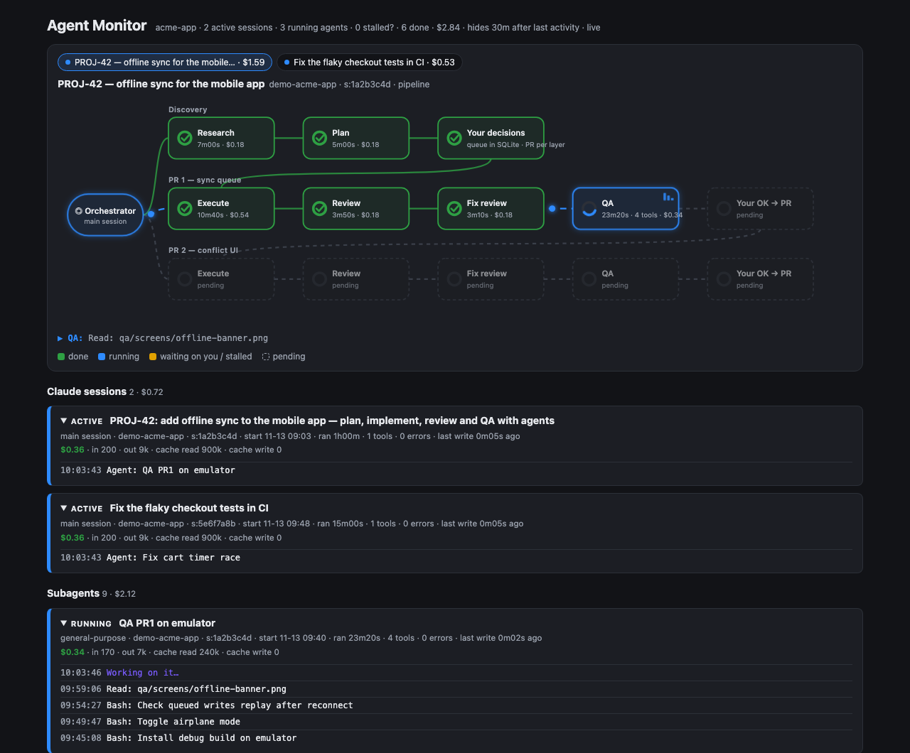
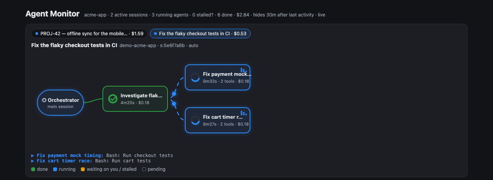

# agent-monitor

A Claude Code plugin: a live local dashboard (http://127.0.0.1:8765) of the Claude Code sessions running in the repos you watch.

- One tab per live session, with an animated orchestration graph: the main session fans out to its subagents, parallel agents share a column, and a moving dot shows where work is happening now.
- An optional stage pipeline per task (Research → Plan → Execute → Review → Fix → QA → your OK), so you also see the steps that haven't started yet.
- Each node shows what the agent is doing now; click it for its prompt, tool-call timeline and final report. Pan and zoom the graph.
- Default view is a **Tree**: session → lanes → stages → agents, left to right, as readable cards joined by curved lines. Every branch folds (▸/▾); live branches open down to the running agent, finished ones fold to a count badge (`5 ✓ · 1 ◔`). Your folds are remembered; **Expand all** / **Collapse finished** / **Fit**.
- **Lanes** is a board, one row per lane (task pipeline lanes, else one per question); **Flow** is the flow graph. **Tree · Lanes · Flow** switches views (remembered).
- Two **Team** panels sit above the session panel. **Team** lists every custom agent in `~/.claude/agents/`, live or not: green while one of its runs is working (×N when several), amber when waiting on you or stalled, red when its last run had tool errors, dim when idle; showing `model · effort`, with its live runs (task, session, time, current tool), its last finished run, and runs and cost today. **Team flow** draws, per shown session that used team members, You → PdM → Developers → Review → QA (plus a Helpers column for used agents without a staff role) with arrows in the order the runs started (parallel runs branch from the same member); unused members are dimmed. Dispatch notes another hook writes to `events.jsonl` (reassign ↪, downgrade ↓) show on the run they caused. Click a member for that run's details.
- Progress and time estimates: `done/total` per lane with a bar, `last activity 12s ago` on running agents (amber `stalled?` when quiet), and `usually ~2m · ~1m left (estimate)` from the median of your finished agents with the same role (shown only with 3+ runs).
- Live tool calls, errors, tokens and estimated cost for every session and agent.
- Only watched repos (plus their worktrees). Finished, idle or cleared sessions drop off on their own.



Sessions that weren't tracked get an automatic graph. Agents that ran at the same time share a column:



*Screenshots use made-up demo data.*

It only reads Claude Code's transcripts in `~/.claude/projects/` and keeps its own state in `~/.claude/agent-monitor/`. It uses only the Python standard library and listens on `127.0.0.1`.

## What it runs and touches

- **Reads:** Claude Code's session transcripts under `~/.claude/projects/` (`*.jsonl` and `*/subagents/agent-*.jsonl` with their `.meta.json`), only for the repos in your watch list; and the frontmatter (name, description, model, effort) of your custom agents in `~/.claude/agents/*.md` for the Team panels, and `~/.claude/agent-monitor/events.jsonl` if another hook writes it.
- **Writes:** only `~/.claude/agent-monitor/scopes.json` (the watch list) and `~/.claude/agent-monitor/pipelines/*.json` (task pipelines you or Claude create).
- **Runs:** `python3 monitor.py`, a stdlib HTTP server bound to `127.0.0.1:8765`, and `git rev-parse --git-common-dir` to map a worktree to its main checkout. The skill also `curl`s `http://127.0.0.1:8765/api` to see whether the server is up, and `open`s the page in your browser.
- **Network:** no outbound requests. Nothing is sent anywhere; the page and its data never leave your machine. No dependencies to install.
- **Personal data:** transcripts can contain whatever you typed in your sessions; the dashboard shows excerpts of them (prompts, tool calls) to you, locally. Nothing is stored beyond the two files above. See [Privacy](PRIVACY.md).

## Install

```sh
claude plugin marketplace add sr1k3sh/claude-agent-monitor
claude plugin install agent-monitor@sr1k3sh-plugins
```

Or inside a Claude Code session: `/plugin marketplace add sr1k3sh/claude-agent-monitor`, then `/plugin install agent-monitor@sr1k3sh-plugins`.

Not listed in the Claude plugin directory: the directory accepts plugins that ship scripts or hooks only from verified organizations, and this one runs a small local Python server. Install it from this repository's marketplace as above.

Update: `claude plugin marketplace update sr1k3sh-plugins && claude plugin update agent-monitor@sr1k3sh-plugins`, then `/reload-plugins`.

From a local clone: `claude plugin marketplace add /path/to/claude-agent-monitor`, then install the same way. Edits apply on the next session or after `/reload-plugins`.

## Use

In a session inside the repo you want to watch:

- `/agent-monitor:monitor`: adds this repo to the watch list, starts the dashboard if it isn't running, and opens it.
- `/agent-monitor:monitor track <title>`: adds a stage pipeline for this session's task.
- `/agent-monitor:monitor unwatch`: stops watching this repo.

Without Claude: `python3 skills/agent-monitor/monitor.py scope add <repo>`, then `python3 skills/agent-monitor/monitor.py`.

## Settings

| Env var | Default | Meaning |
|---|---|---|
| `HIDE_AFTER_MIN` | `30` | Minutes of no activity before a session with agents is hidden |
| `AGENT_MONITOR_HOME` | `~/.claude/agent-monitor` | Where `scopes.json` and `pipelines/` live |
| `CLAUDE_PROJECTS_DIR` | `~/.claude/projects` | Claude Code transcripts |
| `CLAUDE_AGENTS_DIR` | `~/.claude/agents` | Custom agents listed in the Team panels |

Costs are estimates at public API prices (`skills/agent-monitor/prices.json`), not your bill.

## Test

```sh
python3 -m unittest skills/agent-monitor/test_monitor.py
```
